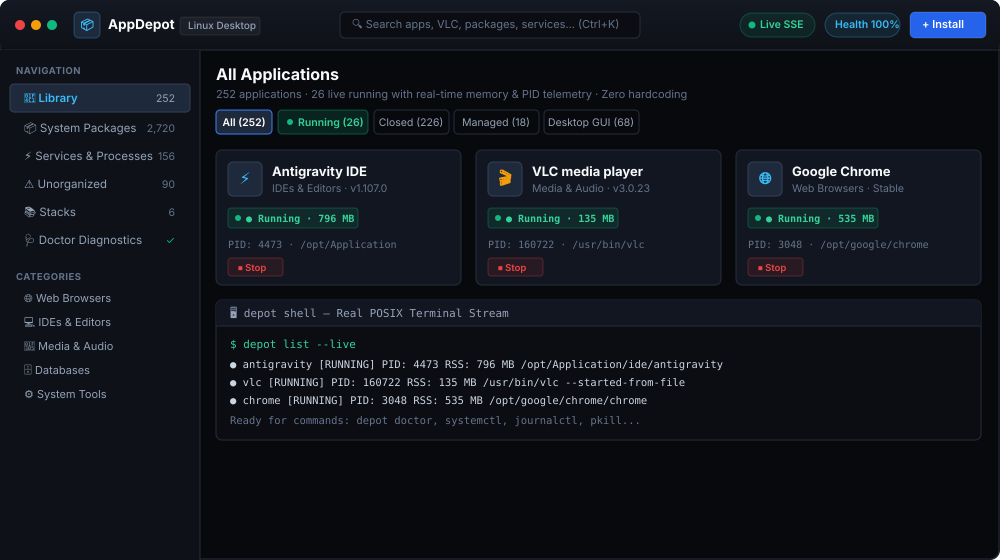
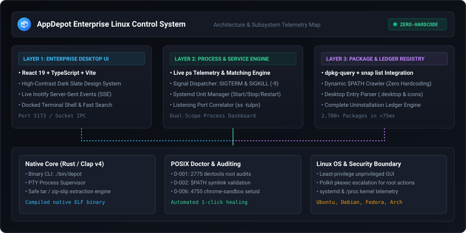
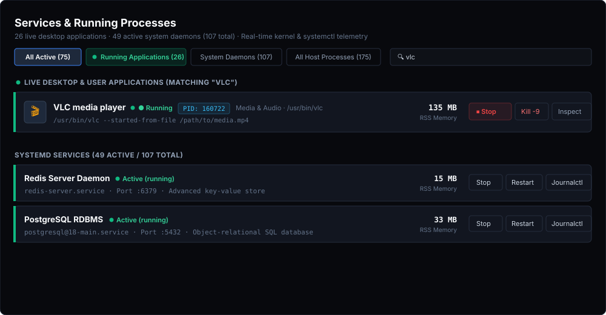
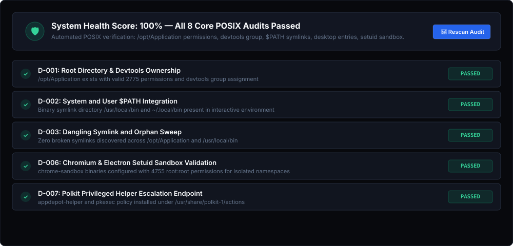

# AppDepot 📦

> **The Universal Linux Application & System Management Control Panel**
>
> An enterprise-grade Windows *"Programs & Features"*, macOS *`/Applications`*, and unified *"Control Panel"* engineered specifically for Linux workstations and enterprise deployments. Manage, inspect, organize, and control every installed application, live desktop process (such as VLC, Chrome, IDEs), systemd daemon (both active and stopped), and host system package (APT/DPKG & Snap) from one cohesive control center with zero hardcoded registries and real-time kernel inotify telemetry.

<!-- 👤 MANUAL ACTION: Replace the badge repository URLs and project links below with your official GitHub/GitLab endpoints -->
[](LICENSE)
[](https://www.rust-lang.org/)
[](apps/gui)
[](#key-features)
[](#system-compatibility)
[](#1-zero-hardcoding-dynamic-discovery-engine)

---

<!-- 👤 MANUAL ACTION [ASSET 1/4]: Figure 1 - Dashboard Overview
     Replace docs/assets/dashboard-overview.svg with your custom SVG or PNG screenshot.
     If using PNG, change src="docs/assets/dashboard-overview.svg" to src="docs/assets/dashboard-overview.png".
     Recommended dimensions: 1920x1080 or 1440x900 (Dark Slate theme).
-->
<p align="center">
  
  <br />
  <em>Figure 1: AppDepot Enterprise Control Center Dashboard — Unified Application Library with Real-Time Memory Telemetry, Running State Badges, and Docked Terminal Shell</em>
</p>

---

## 📌 Manual Customization Guide (Sections You Update Manually)

To help you personalize, brand, and publish AppDepot for your exact environment or proprietary distribution, the table below highlights every place in this repository and documentation that requires your manual input:

| Item # | Target Area / File | Action Required from You | Status |
| :---: | :--- | :--- | :---: |
| **1** | [docs/assets/dashboard-overview.svg](file:///home/besu/projects/appdepotforlinux/docs/assets/dashboard-overview.svg) | **Replace Figure 1:** Drop in your final dashboard screenshot or vector SVG (1920x1080). | ⏳ *Manual* |
| **2** | [docs/assets/architecture-diagram.svg](file:///home/besu/projects/appdepotforlinux/docs/assets/architecture-diagram.svg) | **Replace Figure 2:** Customize or replace the system architecture subsystem diagram. | ⏳ *Manual* |
| **3** | [docs/assets/services-and-processes.svg](file:///home/besu/projects/appdepotforlinux/docs/assets/services-and-processes.svg) | **Replace Figure 3:** Screenshot your live Services & Running Processes view (with VLC/daemons). | ⏳ *Manual* |
| **4** | [docs/assets/doctor-audit.svg](file:///home/besu/projects/appdepotforlinux/docs/assets/doctor-audit.svg) | **Replace Figure 4:** Screenshot the POSIX Doctor health audit diagnostic card grid. | ⏳ *Manual* |
| **5** | [README.md: Quick Launch](file:///home/besu/projects/appdepotforlinux/README.md#one-command-quick-launch) | **Update Git Remote:** Replace `https://github.com/besu/appdepot.git` with your public or private Git URL. | ⏳ *Manual* |
| **6** | [LICENSE](file:///home/besu/projects/appdepotforlinux/LICENSE) | **License Type:** If publishing as a closed-source commercial app, replace MIT with your Commercial EULA. | ⏳ *Manual* |
| **7** | [PACKAGING_AND_PROTECTION_GUIDE.md](file:///home/besu/projects/appdepotforlinux/PACKAGING_AND_PROTECTION_GUIDE.md) | **Package Maintainer:** Update author name, organization email, and version in `DEBIAN/control`. | ⏳ *Manual* |
| **8** | [scripts/build-protected-dist.sh](file:///home/besu/projects/appdepotforlinux/scripts/build-protected-dist.sh) | **Signing & Release Keys:** Add your developer GPG/PGP key for signing `.deb` and `.AppImage`. | ⏳ *Manual* |

---

## 🌟 Executive Overview

On conventional Linux workstations and servers, software administration is fragmented across dozens of disconnected terminal utilities (`systemctl`, `dpkg`, `apt`, `snap`, `which`, `ps aux`, `kill`, `ss -tulpn`, `ls -l /opt`). Users and system administrators are forced to memorize obscure flags to check why a service halted, which PID is consuming memory, where a desktop app binary lives, or what files a package installed.

**AppDepot** bridges this divide. It delivers a unified, zero-hardcoding desktop control center that monitors, tracks, and manages every piece of software on your machine:

```
┌────────────────────────────────────────────────────────────────────────────────────────────────────────┐
│                                       AppDepot Linux Control Center                                    │
├────────────────────────┬───────────────────────────────────────────────┬───────────────────────────────┤
│  NAVIGATION            │  ACTIVE WORKSPACE DASHBOARD                   │  DOCKED LIVE SHELL (PTY)      │
│  • Library (250+ Apps) │  • Categorized App Grid with RSS Telemetry    │  • Real Interactive Terminal  │
│  • System Packages     │  • Dual-Scope Process & Service Monitor       │  • Live Inotify SSE Feed      │
│  • Services & Processes│  • 2,720+ Host Package Registry (APT & Snap)  │  • Built-in CLI Diagnostics:  │
│  • Unorganized Binaries│  • Interactive Filesystem & Folder Maker      │    - depot list               │
│  • Stacks (Toolchains) │  • Automated POSIX Doctor Health Audits       │    - depot doctor --fix       │
│  • Doctor Diagnostics  │  • One-Click Signal Controls (SIGTERM/SIGKILL)│    - journalctl -u <unit>     │
└────────────────────────┴───────────────────────────────────────────────┴───────────────────────────────┘
```

---

<!-- 👤 MANUAL ACTION [ASSET 2/4]: Figure 2 - Architecture Subsystem Diagram
     Replace docs/assets/architecture-diagram.svg with your custom SVG diagram or screenshot.
     If using PNG, change src="docs/assets/architecture-diagram.svg" to src="docs/assets/architecture-diagram.png".
     Recommended dimensions: 1920x1080 or vector SVG.
-->
<p align="center">
  
  <br />
  <em>Figure 2: AppDepot Subsystem Architecture — Presentation Layer, Real-Time Process & Service Telemetry Engine, Package Registry, and POSIX Foundation</em>
</p>

---

## 🚀 Core Capabilities

### 1. 🔍 Zero-Hardcoding Dynamic Discovery Engine
* **Dynamic Binary Crawler:** Zero static registries or hardcoded lists. AppDepot crawls active `$PATH` directories (`/usr/local/bin`, `~/.cargo/bin`, `~/.local/bin`, `/snap/bin`, `/usr/bin`) in real time. Any compiler, CLI utility, or desktop tool installed now or in the future is instantly detected and categorized.
* **Kernel Inotify & Server-Sent Events (SSE):** Real-time kernel filesystem watcher. Dropping a folder or archive into `/opt/Application` or creating desktop shortcuts immediately updates the GUI without polling lag.
* **Smart Categorization Engine:** Dynamically infers categories (`IDEs & Editors`, `Media & Audio`, `Web Browsers`, `Databases`, `Runtimes`, `System Tools`) from `.desktop` category metadata, package sections, and binary properties.

---

<!-- 👤 MANUAL ACTION [ASSET 3/4]: Figure 3 - Services & Running Processes Monitor
     Replace docs/assets/services-and-processes.svg with your live screenshot of the Services & Processes tab.
     If using PNG, change src="docs/assets/services-and-processes.svg" to src="docs/assets/services-and-processes.png".
     Recommended dimensions: 1920x1080 or 1440x900 (showing both running apps like VLC and systemd units).
-->
<p align="center">
  
  <br />
  <em>Figure 3: Services & Running Processes Monitor — Dual-Scope Telemetry showing Live Desktop Application Processes (e.g. VLC Media Player) alongside Systemd Services with Instant Signal Actions</em>
</p>

---

### 2. ⚡ Services & Live Process Control Center
* **Unified Dual-Scope Telemetry:** View and control both live user desktop applications (such as VLC media player, Google Chrome, Antigravity IDE, Telegram) and background `systemd` daemons (`redis-server`, `postgresql`, `cups`, `bluetooth`).
* **Live Process Memory & PID Inspection:** Real-time query of `ps -eo pid,user,%cpu,%mem,rss,stat,comm,args` correlated directly to installed applications.
* **Signal Dispatching:**
  * **Graceful Termination (`SIGTERM / -15`):** Sends graceful shutdown signals to processes or systemd units.
  * **Force Kill (`SIGKILL / -9`):** Immediate emergency process termination for unresponsive software.
* **Cross-Scope Intelligent Search:** Searching for any application (e.g., `vlc`) immediately surfaces the active process, memory footprint, and controls regardless of which sub-tab is active.
* **Systemd Daemon Control:** One-click Start, Stop, Restart, Autostart enable/disable toggle, and live `journalctl -n 40` log streaming.

### 3. 📦 Complete System Package Database (2,720+ Packages)
* **Comprehensive Host Registry:** Queries all installed Debian/Ubuntu packages via `dpkg-query` and Snap packages via `snap list` in under 75 milliseconds.
* **Deep Package Inspection:**
  * **File Manifest:** Inspect every file installed on disk by a package (`dpkg -L`).
  * **Package Status:** Upstream maintainer, version, architecture, and description (`dpkg -s`).
  * **Dependency Tree:** Inspect upstream prerequisites (`apt-cache depends`).
  * **Safe Removal:** Uninstall packages cleanly via Polkit-authenticated package manager actions.

### 4. 📁 Interactive Filesystem Explorer & Folder Creator
* **Full-System Path Browser:** Browse `/opt/Application`, `/usr/local`, home directories, and system volumes with breadcrumb navigation.
* **In-Flow Directory Creation:** Create new folders (`mkdir`) directly inside the installation wizard with automated permission checking and slug validation.
* **Native Desktop Dialogs:** Automated fallback integration with KDE (`kdialog`), GNOME (`zenity`), or file chooser interfaces.

---

<!-- 👤 MANUAL ACTION [ASSET 4/4]: Figure 4 - POSIX System Doctor Diagnostics
     Replace docs/assets/doctor-audit.svg with your live screenshot of the Doctor Diagnostics tab.
     If using PNG, change src="docs/assets/doctor-audit.svg" to src="docs/assets/doctor-audit.png".
     Recommended dimensions: 1920x1080 or 1440x900.
-->
<p align="center">
  
  <br />
  <em>Figure 4: POSIX System Doctor Diagnostics — Real-Time Host Auditing, Sandbox Validation, Permission Checks, and One-Click Automated Healing</em>
</p>

---

### 5. 🩺 POSIX System Doctor & Automated Healing
Built-in automated audit engine continuously inspecting workstation health:
* **D-001 (Root Permissions):** Verifies `/opt/Application` exists with `2775` permissions and `devtools` group ownership.
* **D-002 (PATH Configuration):** Audits `/usr/local/bin` and `~/.local/bin` in interactive shell environments.
* **D-003 (Dangling Symlinks):** Sweeps and removes broken symlinks pointing to deleted targets.
* **D-006 (Setuid Sandbox Audit):** Audits Chromium and Electron applications (`chrome-sandbox`) for required `4755 root` setuid flags for kernel namespace isolation.
* **One-Click Auto-Fix:** Automated resolution via Polkit helper or typed terminal commands.

---

## 🛠️ Getting Started

### Prerequisites

* **Operating System:** Ubuntu, Kubuntu, Debian, Fedora, Arch Linux, or any standard Linux distribution.
* **Node.js:** v18.0.0 or higher
* **Rust (Optional for Native CLI):** v1.78+ (`rustup default stable`)

### One-Command Quick Launch

Clone and start the interactive desktop application immediately:

<!-- 👤 MANUAL ACTION: Replace with your actual repository URL (e.g. https://github.com/YOUR_ORGANIZATION/appdepot.git) -->
```bash
git clone https://github.com/besu/appdepot.git
cd appdepot

# Launch the desktop GUI, background engine, and inotify watcher
./start.sh
```

AppDepot will start on **`http://127.0.0.1:5173/`** with live inotify watching and full system control.

### One-Command Protected Binary Packaging

To bundle and compile AppDepot into an **un-extractable, closed-source distribution** with V8 machine bytecode, AST obfuscation, and stripped native ELF binaries:

```bash
# 1. Run the one-click protected packaging pipeline
./build.sh

# 2. Output packages generated in dist-release/:
#    • dist-release/appdepot_1.0.0_amd64.deb        (Official Debian/Ubuntu package)
#    • dist-release/appdepot-1.0.0-linux-x64.tar.gz (Standalone portable archive)

# 3. Install on Ubuntu/Debian system-wide:
sudo dpkg -i dist-release/appdepot_1.0.0_amd64.deb

# 4. Or run the portable bundle directly on any Linux machine:
tar -xzf dist-release/appdepot-1.0.0-linux-x64.tar.gz
cd appdepot && ./appdepot
```

---

## 💻 CLI Commands (`depot`)

AppDepot includes a companion native binary `depot` located in `./bin/depot`:

```bash
# List all managed applications and running states in /opt/Application
./bin/depot list

# Inspect detailed ledger artifacts and metadata for an app
./bin/depot info <app_name>

# Run comprehensive POSIX system diagnostics
./bin/depot doctor

# Automatically fix identified system permissions and dangling symlinks
./bin/depot doctor --fix

# Show environment paths and toolchain variables
./bin/depot env show
```

---

## 📁 Repository Structure

```
├── apps/
│   └── gui/                          # React + TypeScript + Vite Desktop GUI
│       ├── server/
│       │   └── systemScanner.ts      # Zero-hardcode dynamic path & service crawler
│       ├── src/
│       │   ├── App.tsx               # Main management interface & views
│       │   ├── App.css               # Modern Deep Dark CSS design system
│       │   └── main.tsx              # Application entry point
│       └── vite.config.ts            # Vite dev server + live REST/SSE API endpoints
├── bin/
│   └── depot                         # Native CLI launcher
├── crates/
│   ├── appdepot-cli/                 # Rust CLI crate (clap v4)
│   ├── appdepot-core/                # Rust core engine & safe extractor
│   ├── appdepot-helper/              # Privileged Polkit root helper
│   ├── appdepot-pty/                 # Rust PTY process supervisor
│   └── appdepot-types/               # Shared IPC schemas
├── docs/
│   ├── assets/                       # UI diagrams & figure references (Replace with your SVGs/Screenshots)
│   │   ├── architecture-diagram.svg  # Subsystem architecture map
│   │   ├── dashboard-overview.svg    # Dashboard overview diagram
│   │   ├── services-and-processes.svg# Services and process monitor
│   │   └── doctor-audit.svg          # POSIX system doctor diagram
│   └── *.md                          # Technical specifications
├── scripts/
│   └── build-protected-dist.sh       # Automated anti-reverse-engineering packager
├── PACKAGING_AND_PROTECTION_GUIDE.md # Binary packaging & IP protection manual
├── TEST_WORKFLOW_GUIDE.md            # Step-by-step test verification manual
├── start.sh                          # One-click desktop launcher
└── README.md                         # This file
```

---

## 🔒 Security & Safety Model

AppDepot enforces a strict **Least Privilege Architecture**:
1. **Unprivileged GUI:** The graphical interface runs entirely as your standard, unprivileged user.
2. **Safe Extraction Engine:** Protects against zip-slip and symlink directory traversal attacks before archive files are written.
3. **Explicit Root Escalation:** Sensitive actions (systemd daemon control, package uninstallation, setuid permission fixes) require explicit Polkit authentication (`pkexec`) with human confirmation.
4. **Clean Artifacts Ledger:** Every created symlink, desktop entry, and extracted directory is registered for 100% clean, one-click uninstallation without orphan files.

---

## 📦 Closed-Source Binary Packaging & IP Protection

To distribute AppDepot publicly as a compiled binary package without exposing your source code or allowing reverse engineering:

👉 **[PACKAGING_AND_PROTECTION_GUIDE.md](file:///home/besu/projects/appdepotforlinux/PACKAGING_AND_PROTECTION_GUIDE.md)**

Includes instructions on:
* AST Obfuscation & String Array Encryption
* V8 Bytecode Compilation (`bytenode`)
* Native ELF compilation with stripped symbols (`strip --strip-all`)
* Standalone `.deb`, `.AppImage`, and `.tar.gz` distribution generation

---

## 🧪 Testing & Verification Walkthrough

To verify installing a real application package, inspecting it live through AppDepot, monitoring its process, and completely uninstalling it:

👉 **[TEST_WORKFLOW_GUIDE.md](file:///home/besu/projects/appdepotforlinux/TEST_WORKFLOW_GUIDE.md)**

---

## 📄 License

<!-- 👤 MANUAL ACTION: Update licensing if distributing as closed-source commercial software.
     - For open-source releases: Keep the MIT License.
     - For proprietary / commercial binary releases: Replace this section with your Commercial EULA / Proprietary License.
-->
This project is licensed under the [MIT License](LICENSE).

